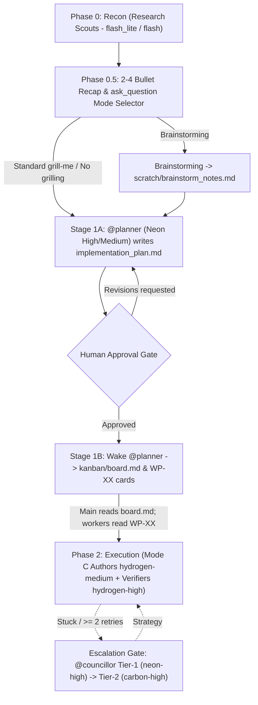

# Token-Efficient Task Orchestrator (v2.0.0 — Three-Family Model Matrix)

> [!CAUTION]
> **Experimental Software — Use Strictly at Your Own Risk**
>
> This orchestrator is an **experimental project** provided **"AS IS"** with **zero warranty** and **zero liability**. By using it, you accept full responsibility for all outcomes—the author assumes **no liability** (*not my problem*) for any agent lock-ups, infinite or retry loops, excessive token/quota burn, inefficiencies, blocked tool calls, or unexpected agent behavior.
>
> **Recommended Installation Approach:** Instead of a direct, blind drop-in installation, **inspect the source code and rules first** (`hooks/orchestrator_guard.py`, `rules/AGENTS.md`, `skills/token-efficient-orchestrator/SKILL.md`, `skills/orchestrator-planner/SKILL.md`), or **have your own AI coding agent review, adapt, and install it** to fit your specific environment, tools, and workflow needs.

A high-precision, token-efficient cognitive orchestration system for **Google Antigravity** (cognitive architecture **v2.0.0**). Built around the **Three-Family Model Matrix** (`Hydrogen` + `Neon` + `Carbon` — with all `xhigh` variants and `Orchestrator (Neon)/(Carbon)` wrappers unconditionally banned): **Hydrogen** (Low, Medium, High) handling 80%+ of Recon and Execution (`Mode C` Authors on `hydrogen-medium`, Verifiers on `hydrogen-high`), **Neon** (Low, Medium, High) powering the standalone Main Session (`gemini-4-neon-medium` default), `@planner` (`neon-high` multi-WP / `neon-medium` single-WP), and Tier-1 `@councillor` (`neon-high`), and **Carbon** (Low, Medium, High) reserved strictly for Tier-2 `@councillor` deadlock escalation (`carbon-high`), complex cross-system `@planner` fallback (`carbon-high`), and gated `@auditor` security & compliance audits (`carbon-high`).

---

## 🖥️ Platform Editions: Windows vs. Linux (Quick Pick)

The `main` branch hosts synchronized, side-by-side platform bundles so every file is directly browseable on GitHub without switching branches:

1. [`windows/`](./windows/) — **Dedicated Windows Edition** (`hooks.json`: `python -B hooks/orchestrator_guard.py`, tailored for `%USERPROFILE%\.gemini\config\plugins\orchestrator\`).
2. [`linux/`](./linux/) — **Dedicated Linux Edition** (`hooks.json`: `python3 -B hooks/orchestrator_guard.py`, executable `100755` scripts, POSIX + PowerShell command guards, tailored for `~/.gemini/config/plugins/orchestrator/`).
3. `/` (Repository Root) — **Universal / Windows-Compatible Default** (mirrors `windows/` at root so cloning root directly into `plugins/orchestrator` works out-of-the-box).

| Edition | Hook Launcher | Key Highlights | Guide |
| :--- | :--- | :--- | :--- |
| **[`windows/`](./windows/)** (Windows) | `python -B` | Native `python.exe`; drive/UNC/MSYS path normalization + v2.0.0 Gemini 4 matrix | [Windows Guide](windows/README.md) |
| **[`linux/`](./linux/)** (Linux / POSIX) | `python3 -B` | Executable `100755` `.py` files; POSIX + PowerShell RO guards; non-blocking FIFO/`stdin` | [Linux Guide](linux/README.md) |
| **[`/`](./)** (Root / Universal) | `python -B` | Mirrors `windows/` for direct `git clone` into `plugins/orchestrator` | [Quick Start](#quick-install-commands) |

> **Hook script:** `hooks/orchestrator_guard.py` · **Install destination:** `%USERPROFILE%\.gemini\config\plugins\orchestrator\` (Windows) or `~/.gemini/config/plugins/orchestrator/` (Linux).

### Quick Install Commands

**Windows (PowerShell):**
```powershell
New-Item -ItemType Directory -Force "$env:USERPROFILE\.gemini\config\plugins\orchestrator" | Out-Null
Copy-Item -Recurse -Force ".\windows\*" "$env:USERPROFILE\.gemini\config\plugins\orchestrator\"
```

**Linux (Bash):**
```bash
mkdir -p ~/.gemini/config/plugins/orchestrator
cp -a ./linux/. ~/.gemini/config/plugins/orchestrator/
chmod +x ~/.gemini/config/plugins/orchestrator/hooks/orchestrator_guard.py
```

### What's New in v2.0.0 (Windows & Linux)
* **Standalone Neon Main Session & Hard Bans**: Drops `Orchestrator (Neon)/(Carbon)` wrappers and unconditionally hard-bans all `xhigh` thinking modes (enforced in `hooks/orchestrator_guard.py` + `rules/AGENTS.md`); defaults Main Session to standalone `gemini-4-neon-medium` (`$0` fork to Neon `@planner`/`@councillor`).
* **Upgraded Planner, Verifier & Escalation Routing**: Upgrades multi-WP `@planner` to `gemini-4-neon-high` (`gemini-4-neon-medium` for single-WP, `gemini-4-carbon-high` for complex cross-system architecture), standardizes Mode C on `gemini-4-hydrogen-medium` Authors (`workspace="share"`) + `gemini-4-hydrogen-high` Verifiers (`workspace="inherit"`), upgrades Tier-1 → Tier-2 `@councillor` to `gemini-4-neon-high` → `gemini-4-carbon-high`, and gates `@auditor` (`gemini-4-carbon-high`) to `> 3` WPs or security/compliance tasks.
* **Hybrid Role-Aware Dual-Skill Split**: Keeps `rules/AGENTS.md` lean and always-active while splitting heavy Stage 1A/1B Kanban schemas into a dedicated `skills/orchestrator-planner/SKILL.md` alongside `skills/token-efficient-orchestrator/SKILL.md`.
* **`/usage` Quota Throttle Ladder & Guard Tests**: Adds 4-tier quota throttling (`Nominal` / `Throttle` / `Survival` / `Cloud Fallback`) and expands unit tests for unconditional banned-model enforcement.

#### Why v2.0.0?
* **Why `Orchestrator (Neon)/(Carbon)` wrappers (`gemini-pro-orchestrator*`) were dropped**: Wrapper dispatchers introduced KV-cache collapse across wrapper hops, triggered `plan_mode` hook conflicts that blocked writes to `scratch/brainstorm_notes.md`, caused silent `gemini-flash-worker-agy` scout bloat, and created post-`exit_plan_mode` `fork="coordinator"` race conditions. Running the Main Session directly on standalone `gemini-4-neon-medium` restores `$0` same-family `fork="coordinator"` prefix-cache reuse into Neon `@planner` and `@councillor` (eliminating the `$0.112` cross-family cold-start penalty).
* **Why all `xhigh` thinking modes were unconditionally banned**: All `*xhigh*` variants (`gemini-4-hydrogen-xhigh`, `gemini-4-neon-xhigh`) impose steep cost and latency degradation with negligible reasoning gain over `high`, and `gemini-4-carbon-xhigh` is invalid and returns `HTTP 400`.
* **Why the Hybrid Role-Aware dual-skill split exists & why execution workers skip skills**: `rules/AGENTS.md` remains lean, dense, and always-active (95% KV-cached), carrying every universal worker law (`STATUS:` contract, circuit-breaker hand-off, prompt/message caps, and hard bans). Heavy Stage 1A/1B Kanban schemas are isolated in `skills/orchestrator-planner/SKILL.md` (loaded only by `@planner`), while extended fleet playbooks reside in `skills/token-efficient-orchestrator/SKILL.md` (loaded by the Main Session only when needed). Execution workers (`research` scouts, Mode A/B/C Authors and Verifiers) intentionally skip `read_file` on skills to eliminate wasted turn tax.

### What's New in v1.3.0 (Windows & Linux)
* **Phase 0.5 Pre-Grilling Mode Selector & Brainstorming**: Replaces the rigid Deterministic Checkpoint with a 2–4 bullet Phase 0 recon recap and an `ask_question` mode selector (`Standard grill-me`, `No grilling needed`, `Brainstorming`) with dynamic `(Recommended)` ordering, explicit prompt overrides, and mandatory distillation of Brainstorming sessions into `<artifactDirectoryPath>/scratch/brainstorm_notes.md`.
* **Two-Stage 3-Layer Kanban Planning (`implementation_plan.md` → Lazy `kanban/`)**: Stage 1A produces a lean 4-section human-control `implementation_plan.md`; post-approval, Stage 1B wakes sleeping `@planner` (warm KV cache) to materialize `kanban/board.md` (Main Session dispatch index) and self-contained `kanban/WP-XX_<slug>.md` worker cards (`UserFacing: false, RequestFeedback: false`).
* **Guard Hardening & Unified `v1.3.0` Versioning**: Enforces `@planner`-only write authority on `implementation_plan.md` and `kanban/**`, blocks Main Session writes to `kanban/**` while keeping `kanban/board.md` read-only, blocks stale `/brain/<other_id>/kanban/**` cross-session access, and unifies all active version strings across root `/`, `linux/`, and `windows/` to `v1.3.0`.

### What's New in v1.2.0 (Windows & Linux)
* **Gemini Neon Migration (4 Thinking Levels)**: Historically upgraded the Three-Family Model Matrix to **Gemini Neon** (`gemini-4-neon-low`, `gemini-4-neon-medium`, `gemini-4-neon-high`, `gemini-4-neon-xhigh`) for `@planner` and Tier-1 `@councillor`, and updated the fast dispatcher to **`Orchestrator (Neon)`** (`gemini-pro-orchestrator-neon`) *(both `xhigh` levels and `Orchestrator` wrapper modes were subsequently superseded and banned in `v2.0.0`)*.
* **Synchronized Three-Tree Update**: Updated `hooks/orchestrator_guard.py` (Tier-1 `"neon"` escalation state and messages), `rules/AGENTS.md`, `skills/token-efficient-orchestrator/SKILL.md`, `plugin.json` (`1.2.0`), and `tests/test_orchestrator_guard.py` (`TestNeonAndCarbonEscalation`) identically across root `/`, `linux/`, and `windows/`.

### What's New in v1.1.0 (Windows & Linux)
* **Side-by-Side Platform Bundles on `main`**: Dedicated [`windows/`](./windows/) (`python -B`) and [`linux/`](./linux/) (`python3 -B`, `100755` executable scripts) editions alongside the Windows-compatible root bundle.
* **Linux POSIX Hardening**: POSIX Read-Only command blocking alongside PowerShell guards, plus cross-platform path normalization across Windows drives, UNC, MSYS, and POSIX paths.
* **Non-Blocking FIFO & `stdin` I/O**: Named-pipe/FIFO checks prevent `_read_text_with_retry` from hanging on unbuffered pipes, and `_read_stdin_nonblocking` safely handles delayed-EOF payloads with a byte cap.
* **`MessagesCache` (~7x I/O Reduction)**: Thread-safe bounded directory/file-stamp cache for `.system_generated/messages/*.json` eliminates redundant disk reads on every tool hook invocation.
* **CWD Allow-List Isolation**: Hook working directories inside `.gemini/config/plugins/orchestrator` no longer leak allow-list access to relative or cross-platform paths.
* **Plan Mode & Guard Accuracy**: Added `enter_plan_mode` / `exit_plan_mode` Main Session allow-list support, ReDoS bounds on regex matching, and lazy parent-ID resolution for subagent wrap-up detection.

---

## 🎯 Proposed Usage Guide

1. **UI Model Picker Setup**:
   * Select standalone **`Gemini 4 Neon (Medium)`** (`gemini-4-neon-medium`) for the Main Session to enable `$0` same-family `fork="coordinator"` cache reuse into Neon `@planner` and `@councillor`.
   * Use rare manual overrides only when warranted: **`Neon High`** (complex greenfield Phase 0.5 brainstorming), **`Carbon Medium`** (formal verification, cryptography, or consensus invariants), or **`Neon Low` / `Hydrogen High`** (quota throttling or pure mechanical dispatch).
2. **Post-Reload Thinking-Skip Check**:
   * Antigravity UI dropdown resets after window reloads or updates can silently trigger **thinking skip** (zero-reasoning instant tool calls). Always verify both the selected model and thinking-effort level after any UI reload before starting a task.
3. **Phase 0–2 Workflow Tips, Prompt Overrides & Operational Hygiene**:
   * **Phase 0 & Phase 0.5**: Phase 0 runs read-only Hydrogen recon automatically, then presents a concise 2–4 bullet recap and an `ask_question` mode selector (`Standard grill-me`, `No grilling needed`, `Brainstorming`).
   * **Explicit Prompt Overrides**: Include `"skip grilling"`, `"no grilling"`, or `"let's brainstorm"` directly in your initial prompt to select the alignment mode immediately without an extra mode-selector turn.
   * **Two-Stage Planning**: Stage 1A produces a lean 4-section `implementation_plan.md` for human review; Stage 1B wakes the warm `@planner` post-approval to lazily materialize `kanban/board.md` and self-contained `kanban/WP-XX_<slug>.md` worker cards.
   * **Operational Hygiene**: Prune or stage large raw logs and command outputs in `<artifactDirectoryPath>/scratch/` rather than keeping bloated logs in context (even with a `1M` window), and rely on Gemini 4's automatic implicit prefix caching (`> 4,096` tokens, 95% read discount) via same-family `fork="coordinator"` rather than the `cachedContents` explicit caching API (`HTTP 400`).
4. **4-Tier `/usage` Quota Throttle Ladder**:

| `/usage` Remaining | Mode | Main Session | `@planner` & `@councillor` | Mode C Fleet & Controls |
| :--- | :--- | :--- | :--- | :--- |
| **`100% – 40%`** | **Nominal** | `gemini-4-neon-medium` | Multi-WP `@planner`: `gemini-4-neon-high`; Tier-1 `@councillor`: `neon-high` → Tier-2 `carbon-high` | `Med+High` (`hydrogen-medium` Authors + `hydrogen-high` Verifiers); gated `@auditor` (`carbon-high`) active for `> 3` WPs / security. |
| **`40% – 15%`** | **Throttle** | `gemini-4-neon-low` | Pin `@planner` to `gemini-4-neon-medium` | Keep `Med+High` Mode C; disable speculative `Hydrogen High` Author promotions. |
| **`< 15%`** | **Survival** | `gemini-4-hydrogen-medium` (`swarm(action="model")`) | Lean Neon/Hydrogen fallback | `Med+Med` Mode C (`hydrogen-medium` Authors + Verifiers); pause non-blocking `@auditor`; prefer Mode B `run_workflow`. |
| **`0%`** | **Cloud Fallback** | `$40` Cloud credits | Standard lean routing (~20 lean sessions) | Run on `$40` Cloud credits until the rolling 5-hour Ultra quota window resets. |

---

## 🚀 Key Architectural Pillars

### 1. Main Session Commander (Pure Dispatcher)
* **Default & Supported Models**: Defaults to standalone **`gemini-4-neon-medium`** (`$0` fork to Neon `@planner`/`@councillor`), with overrides **`gemini-4-neon-low`**, **`gemini-4-neon-high`**, **`gemini-4-hydrogen-high`**, or **`gemini-4-carbon-medium` / `gemini-4-carbon-high`**. Legacy `Orchestrator (Neon)/(Carbon)` wrappers and all `xhigh` thinking modes are unconditionally banned.
* **Platform-Level Guard**: Enforced via `orchestrator-pure-dispatcher-guard` (`hooks/orchestrator_guard.py`). The Main Session is physically blocked from executing workspace file edits, shell commands (`run_command`), web searches, MCP tools, **writing outside `<artifactDirectoryPath>/scratch/`**, and **directly writing or editing `implementation_plan.md` or `kanban/**`** (retaining read-only access to `<artifactDirectoryPath>/` including `kanban/board.md`).

### 2. Dedicated Swarm Planner, Two-Tier Councillor & Gated Auditor (`Neon` → `Carbon`)
* **Dedicated Swarm Planner (`@planner`)**: Spawned sequentially (`swarm(action="title")` then `swarm(action="add", name="planner", model="gemini-4-neon-high", fork="coordinator", workspace="inherit", brief="...")` in separate turns).
  * **Warm Coordinator Fork**: Inherits complete Phase 0 recon and Phase 0.5 alignment/brainstorming history via `fork="coordinator"`.
  * **Two-Stage 3-Layer Author**: Holds exclusive write authority over `<parentArtifactDirectoryPath>/implementation_plan.md` (Stage 1A lean human-control overview) and `<parentArtifactDirectoryPath>/kanban/**` (Stage 1B post-approval lazy materialization of `kanban/board.md` and `kanban/WP-XX_<slug>.md` cards), guided by the dedicated `skills/orchestrator-planner/SKILL.md` schema skill. (`gemini-4-neon-high` for multi-WP planning, `gemini-4-neon-medium` for single-WP planning, `gemini-4-neon-low` for minor edits, `gemini-4-carbon-high` for complex cross-system architecture; `xhigh` banned.)
  * **Zero Token Cost in Standby**: Sleeps in `waiting` state at zero token cost until nudged via `post_message` (including Stage 1B wakeup).
* **Two-Tier Councillor (`@councillor`) & Gated Auditor (`@auditor`)**:
  * **Tier-1 (`Neon`)**: Spawned via `swarm(action="add", name="councillor", model="gemini-4-neon-high", fork="coordinator", workspace="inherit", brief="...")`. Strictly **Read-Only** (`orchestrator_guard.py` hard-blocks file writes, mutating MCP tools, and mutating shell commands).
  * **Tier-2 (`Carbon`)**: Upgraded in-place via `swarm(action="model", name="councillor", model="gemini-4-carbon-high")` ONLY if Tier-1 Neon cannot resolve the deadlock.
  * **Gated `@auditor` (`Carbon`)**: `gemini-4-carbon-high`, gated strictly to `> 3` WPs or security/compliance tasks.
  * **Guard-Enforced Escalation Gate**: `orchestrator_guard.py` blocks `>= 2` consecutive `invoke_subagent` retries after `STATUS: ESCALATE_REQUIRED`, `CIRCUIT BREAKER`, `NO_VALID_SEND`, or retry keywords (`fix`, `retry`, `remaining`, `pass 2`) until `@councillor` posts a strategy or `ask_question` is consulted.

### 3. 80%+ Hydrogen Execution Fleet, Hybrid Dual-Skill Split & `/usage` Throttle Ladder
* **Mode C — Full Native Swarm (`workspace="share"`)**: **Primary** for multi-file/multi-step coding. Preserves KV-cache across edits and tests, eliminates cold-start waste, and standardizes peer-to-peer collaboration on **`gemini-4-hydrogen-medium` Authors (`workspace="share"`)** + **`gemini-4-hydrogen-high` Verifiers (`workspace="inherit"`)**.
* **Mode B — Dynamic Python Workflows (`run_workflow(parallel=...)`)**: For parallel batch reconnaissance, lint/audit sweeps, and schema-constrained JSON map-reduce pipelines (`flash`). (Calls to stateful or single-threaded MCP servers stay serialized across workers or via `pipeline()`.)
* **Mode A — Ephemeral Subagents (`invoke_subagent`)**: Reserved for single-shot Phase 0 `research` scouts (`flash_lite`/`flash`) and isolated atomic tasks (`self`). Bounded same-WP follow-up `send_message` is permitted for active Phase 2 `self` workers (`< 45` active steps); `research` scouts are strictly single-shot and must be killed upon completion.
* **Hybrid Role-Aware Dual-Skill Architecture**: Keeps `rules/AGENTS.md` lean and always-active while splitting operational fleet templates (`skills/token-efficient-orchestrator/SKILL.md`) from heavy Stage 1A/1B Kanban schemas (`skills/orchestrator-planner/SKILL.md`).
* **`/usage` Quota Throttle Ladder**: 4-tier quota throttling (**Nominal** → **Throttle** → **Survival** → **Cloud Fallback**) to preserve capacity without compromising verification.
* **Zero Polling & Watchdog Spam**: Relies on Antigravity's native reactive wakeup instead of per-turn `schedule(TimerCondition="any")` spam (at most 1 active opt-in watchdog for long-running external/MCP tasks).

### 4. Phase 0.5 Mode Selector, Brainstorming & Shared Scratch
* Immediately after Phase 0 recon, the Main Session presents a 2–4 bullet recap and invokes `ask_question` with a 3-mode selector (`Standard grill-me`, `No grilling needed`, `Brainstorming`) before `@planner` drafts `implementation_plan.md`; Brainstorming sessions distill into `<artifactDirectoryPath>/scratch/brainstorm_notes.md`.
* Phase 2 workers read only their assigned `<parentArtifactDirectoryPath>/kanban/WP-XX_<slug>.md` card, while large payloads are staged in `<artifactDirectoryPath>/scratch/` (`MAX_SUBAGENT_PROMPT_CHARS = 3500`, `MAX_RETURN_MESSAGE_CHARS = 2500`).

---

## 🔄 End-to-End Cognitive Workflow (`v2.0.0`)



---

## 📊 The Three-Family Fleet Matrix (`v2.0.0`)

> **Unconditional Hard Bans:** All `*xhigh*` thinking levels and legacy `Orchestrator (Neon)/(Carbon)` (`gemini-pro-orchestrator*`) wrappers are unconditionally blocked by `hooks/orchestrator_guard.py` and `rules/AGENTS.md`.

| Family | Thinking / Variant | Exact Model ID / Subagent Alias | Primary Cognitive Role | Typical Workloads & Target |
| :--- | :--- | :--- | :--- | :--- |
| **Neon** | **Low / Medium / High** | `gemini-4-neon-medium` (default), `gemini-4-neon-low`, `gemini-4-neon-high` | **Main Session Pure Dispatcher** | Default standalone Main Session (`neon-medium`, `$0` fork to Neon `@planner`/`@councillor`), plus `neon-low`/`neon-high` overrides. |
| **Neon** | **Low / Medium / High** | `gemini-4-neon-high` (multi-WP), `gemini-4-neon-medium` (single-WP), `gemini-4-neon-low` (minor edits) (`swarm`) | **`@planner` & Tier-1 `@councillor`** | Interactive `1M`-context planning (`@planner`) & first-line root-cause diagnosis (`@councillor` on `neon-high`, `workspace="inherit"`). |
| **Hydrogen** | **Low** | `gemini-4-hydrogen-low` (`invoke_subagent: flash_lite`) | Instant Recon & Mechanical | Pre-plan file discovery, log grepping, CSV/JSON transforms, CLI lookups. |
| **Hydrogen** | **Medium** | `gemini-4-hydrogen-medium` (`invoke_subagent: flash`, `run_workflow: flash`, `swarm`: Author) | Routine Execution & Mode C Authors | Deep file/case inspection, routine scripts, unit tests, Mode C Swarm Authors (`workspace="share"`). |
| **Hydrogen** | **High** | `gemini-4-hydrogen-high` (`invoke_subagent: inherit`, `swarm`: Verifier, Main override) | Mode C Verifiers & Workhorse | Mode C Swarm Verifiers (`workspace="inherit"`), complex refactoring, optional Main Session override. |
| **Carbon** | **Low / Medium / High** | `gemini-4-carbon-high` (primary), `gemini-4-carbon-medium/low` (`swarm`, Main override) | **Tier-2 `@councillor`, Complex `@planner` & Gated `@auditor`** | Tier-2 `@councillor` deadlock escalation (`carbon-high`), complex cross-system `@planner` fallback (`carbon-high`), and gated `@auditor` (`carbon-high`, `> 3` WPs or security/compliance). |

---

## 📂 Repository Structure

The repository ships a **Windows-ready root** alongside complete, self-contained **`windows/`** and **`linux/`** drop-in editions (see [Platform Editions: Windows vs. Linux](#-platform-editions-windows-vs-linux-quick-pick) above):

```text
orchestrator/                           # Root edition (Windows-ready default: `python -B`)
├── .gitignore                          # Excludes Python bytecode, caches, and env files
├── LICENSE                             # MIT License
├── hooks.json                          # PreToolUse guard hook registration (`python -B`)
├── hooks/
│   └── orchestrator_guard.py           # Pure-dispatcher, swarm, & subagent boundary guard (v2.0.0)
├── plugin.json                         # Plugin manifest (v2.0.0)
├── README.md                           # Architecture and reference guide
├── rules/
│   └── AGENTS.md                       # Mandatory lean global orchestrator rule (v2.0.0)
├── skills/
│   ├── orchestrator-planner/
│   │   └── SKILL.md                    # Dedicated Stage 1A/1B planning & Kanban schemas
│   └── token-efficient-orchestrator/
│       └── SKILL.md                    # Full Three-Family routing matrix & operational templates
├── tests/
│   ├── __init__.py
│   └── test_orchestrator_guard.py      # Automated unit & regression test suite
├── windows/                            # Drop-in Windows edition (`python -B`, see windows/README.md)
│   ├── hooks.json
│   ├── plugin.json
│   ├── README.md
│   ├── hooks/orchestrator_guard.py
│   ├── rules/AGENTS.md
│   ├── skills/
│   │   ├── orchestrator-planner/SKILL.md
│   │   └── token-efficient-orchestrator/SKILL.md
│   └── tests/{__init__.py,test_orchestrator_guard.py}
└── linux/                              # Drop-in Linux edition (`python3 -B` + `+x`, see linux/README.md)
    ├── hooks.json
    ├── plugin.json
    ├── README.md
    ├── hooks/orchestrator_guard.py
    ├── rules/AGENTS.md
    ├── skills/
    │   ├── orchestrator-planner/SKILL.md
    │   └── token-efficient-orchestrator/SKILL.md
    └── tests/{__init__.py,test_orchestrator_guard.py}
```

---

## 🛡️ PreToolUse Guard Rules Summary (`orchestrator_guard.py` v2.0.0)

| Session Type | Tool / Condition | Decision | Behavior / Reason |
| :--- | :--- | :--- | :--- |
| **Main Session** | `run_command`, `search_web`, `mcp_*`, `call_mcp_tool` | **`deny`** | Pure Dispatcher boundary enforcement. |
| **Main Session** | `read_file` / `write_file` / `edit_file` | **`allow` (scoped)** | Reads: `<artifactDir>/` (incl. `kanban/board.md`) & skill/plugin configs. Writes: strictly `<artifactDir>/scratch/`. Direct `implementation_plan.md` & `kanban/**` writes denied. |
| **Main Session** | `swarm(action="add"|"model")` with banned model (`*xhigh*`, `gemini-pro-orchestrator*`, `Orchestrator (Neon)/(Carbon)`) | **`deny`** | Unconditional banned-model enforcement on swarm spawn and model-upgrade paths. |
| **Main Session** | `invoke_subagent` (Prompt > 3,500 chars or Phase 0 with `self`) | **`deny`** | Anti-bloat cap (`MAX_SUBAGENT_PROMPT_CHARS = 3500`) & strict `TypeName="research"` for recon. |
| **Main Session** | `invoke_subagent` (`retry_streak >= 2` after escalation/CB/retry cues) | **`deny`** | Two-Tier Escalation Gate: consult `@councillor` (Neon → Carbon) or `ask_question`. |
| **Main Session** | `send_message` to `research` or `>= 45` active steps | **`deny`** | `research` scouts are single-shot; `self` workers allow bounded follow-up `< 45` active steps (excluding `read_board`, `swarm_wait`). |
| **Main Session** | `swarm`, `post_message`, `read_board`, `swarm_wait`, `run_workflow`, `ask_question`, `schedule`, `manage_task`, `manage_subagents`, `define_subagent` | **`allow`** | Native Antigravity 2.0 orchestration permitted. |
| **Subagent / Swarm** | `ask_question` | **`deny`** | Enforces bubble-up to Main Session with `STATUS: CLARIFICATION_NEEDED`. |
| **Subagent / Swarm** | `send_message` (> 2,500 chars) | **`deny`** | Anti-bloat cap (`MAX_RETURN_MESSAGE_CHARS = 2500`). Stage large payloads in `scratch/`. |
| **Subagent / Swarm** | `[MCP_ONLY]` worker calling `run_command` or `WRITE_FILE_TOOLS` | **`deny`** | Enforces direct `call_mcp_tool` execution without shell/file detours. |
| **Subagent / Swarm** | Non-`@planner` writing/mutating `implementation_plan.md` or `kanban/**` | **`deny`** | `@planner`-only write lock (file tools & mutating `run_command`); read-only access preserved. |
| **Subagent / Swarm** | Read/write/exec targeting stale `/brain/<other_id>/{scratch,implementation_plan.md,kanban}/` | **`deny`** | Stale-session boundary: only own or resolved parent `<parentArtifactDir>` allowed (all roles incl. `@planner`). |
| **Ephemeral `invoke_subagent`** | `>= 25` steps / `420s` active (RO) or `>= 45` steps / `600s` active (RW) | **`deny` (CB)** | Excludes `429 RESOURCE_EXHAUSTED` gaps. Must immediately call `send_message` (`STATUS: COMPLETED` / `ESCALATE_REQUIRED`). |
| **Persistent Swarm** | `>= 35` steps (RO `@councillor`/RO `@auditor`) or `>= 60` steps (RW) per wakeup | **`deny` (CB)** | Exempt from global wall-clock timeout; counters reset on every wakeup. Must call `post_message` + `swarm_wait`. |
| **CB Exempt Tools** | `send_message`, `read_board`, `swarm_wait`, `post_message`, `manage_subagents`, `schedule` | **`allow`** | All 6 `CIRCUIT_BREAKER_EXEMPT_TOOLS` remain permitted during CB hand-off. |
| **Read-Only (`research`, `@councillor`, RO `@auditor`)** | `WRITE_FILE_TOOLS`, `STATE_MODIFYING_MCP_TOOLS` (incl. mutating mail, draft, event, task, and document tools), mutating `run_command` | **`deny`** | Hard Read-Only isolation. |

---

## 📦 Post-Install Configuration & Customization

> [!IMPORTANT]
> **Do not blindly drop this plugin into a production setup.** Review `hooks/orchestrator_guard.py`, `rules/AGENTS.md`, `skills/token-efficient-orchestrator/SKILL.md`, and `skills/orchestrator-planner/SKILL.md` first, or ask your own AI coding agent to inspect the repository, tailor the guard rules and model IDs to your environment, and handle the installation for you.

After copying the [`windows/`](./windows/) or [`linux/`](./linux/) edition using the [Quick Install Commands](#quick-install-commands) above:
1. Review and customize any workspace-specific rules, model IDs, and circuit-breaker thresholds to match your workflow.
2. Enable the `orchestrator` plugin in Antigravity's **Plugins Manager**.

Optional environment configuration:
* `ORCHESTRATOR_STATE_MODIFYING_MCP_TOOLS`: Comma-separated list of additional MCP tool names or suffixes to block in Read-Only sessions (`research`, `@councillor`, RO `@auditor`).

---

## 🧪 Running Tests

Run the unit and regression test suites without writing `.pyc` bytecode caches:

```bash
python3 -B -m unittest discover -s tests -v
python3 -B -m unittest discover -s windows/tests -v
python3 -B -m unittest discover -s linux/tests -v
```

Or on Windows:

```powershell
python -B -m unittest discover -s tests -v
python -B -m unittest discover -s windows/tests -v
```

---

## 📄 License

This project is licensed under the **MIT License** — see [LICENSE](LICENSE) for details.
